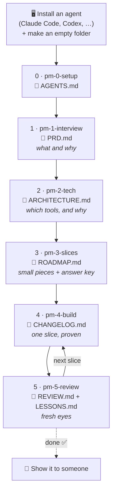

# PM Builder Skills

Six small skills that help a **non-technical person** build a small app with a coding agent,
step by step, with a plan and with proof that it works.

For everyone who takes part in building a digital product: **Product Managers, Product Owners,
Business Analysts, QAs, Scrum Masters**, and anyone else around the product who doesn't write code.

> Start simple. But with a method, not with chaos.

## ⚠️ Read before you use

These are skills from the internet. A skill is text that your agent will follow, so **read each
one before you install it**. They are short, and written in plain English on purpose.

- Use **fake data** while you learn. Never real customer or company data.
- If your company has rules for AI tools, they come first.
- You approve what the agent installs, deletes, spends or publishes.

## The route

Steps 0 to 3 happen **once**. Steps 4 and 5 repeat for **every slice**.
Each step leaves a short file. The next step starts from that file, not from a long chat.

| Step | Skill | You answer… | You get |
|---|---|---|---|
| 0 | `pm-0-setup` | what you'd like to build, roughly | `AGENTS.md`: safety rules for the agent |
| 1 | `pm-1-interview` | questions about the problem, one at a time | `PRD.md`: what we build, for whom, and what NOT |
| 2 | `pm-2-tech` | business questions: users, data, budget | `ARCHITECTURE.md`: tools, and why |
| 3 | `pm-3-slices` | "is this the right answer key?" | `ROADMAP.md`: small slices with acceptance criteria |
| 4 | `pm-4-build` | "yes" to a short plan, then hand checks | the slice, and a `CHANGELOG.md` entry |
| 5 | `pm-5-review` | fix / skip / save as a lesson | `REVIEW.md`, `LESSONS.md` |

## Install

1. Install a coding agent, for example **Claude Code** or **Codex**.
2. Make an empty folder for your project.
3. Copy the skill folders (`pm-0-setup` … `pm-5-review`) into your project, or simply ask the
   agent to install them in your folder and paste a link to this GitHub repo. Where they go:
   - **Codex** (and other tools that use the shared format): `<your project>/.agents/skills/`
   - **Claude Code**: `<your project>/.claude/skills/`
4. Open the folder in the agent.

## Use them one by one

Run one skill at a time, in this order. You can call a skill by name, or just say what you want
in plain words ("let's write the PRD") and the agent will pick the right skill by itself.

| # | What to type | What happens |
|---|---|---|
| 0 | `/pm-0-setup` (Claude Code) · `$pm-0-setup` (Codex) · or "set up my project" | It writes **AGENTS.md**: the rules every agent session reads first. AGENTS.md is not a skill, just a file the agent reads. |
| 1 | `pm-1-interview` · or "interview me about my idea" | Questions, one at a time → **PRD.md** |
| 2 | `pm-2-tech` · or "help me choose the technology" | Options in business language → **ARCHITECTURE.md** |
| 3 | `pm-3-slices` · or "cut it into small slices" | **ROADMAP.md** with acceptance criteria |
| 4 | `pm-4-build` · or "build slice 1" | A short plan for your "yes", then the slice → **CHANGELOG.md** |
| 5 | `pm-5-review` · or "review slice 1" (in a **new** session) | **REVIEW.md**, and lessons in **LESSONS.md** |

Then repeat 4 and 5 for the next slice.

Each skill ends by suggesting the next one, but never starts it by itself. You decide when to
move on.

## How to use them well

- **Review in a fresh session.** The agent that built the slice shouldn't grade its own work.
- **Read the files.** PRD.md and ROADMAP.md are yours. Change them whenever you want.
- **"I don't know" is a good answer.** It becomes an open question, not a guess.
- **Don't expect perfect from scratch.** Look, fix, repeat.

## No agent yet? Use them as prompts

You can paste these into any AI chat. You'll copy files by hand, but the method is the same.

1. **Interview:** "I want to build [idea]. Interview me one question at a time. Give options and
   your recommendation. Don't invent anything: if I don't know, write it as an open question.
   Then write a one-page PRD: problem, main user, smallest first use, must-haves, success, what
   we are NOT doing, open questions."
2. **Tech choice:** "Read my PRD. Propose one safe default and up to two alternatives. For each:
   cost, effort, risk, and what the user would notice, in plain business language. Then list
   what could go wrong in six months. Write ARCHITECTURE.md with the decisions and why."
3. **Slices:** "Split the PRD into small vertical slices: each one something a user can click
   and test. For each: what I'll see, 3 to 5 acceptance criteria (including one unhappy path),
   and what's not in it. No estimates. Write ROADMAP.md."
4. **Build:** "Build only slice [n]. First show me a short plan and wait for my yes. Don't add
   anything else. Prove the acceptance criteria pass. Then write a CHANGELOG entry: what
   changed, what I should check by hand, and the next step."
5. **Review:** "Review slice [n] against its acceptance criteria, the PRD and the architecture.
   List what's missing, what's different and what nobody asked for. Mark each finding Critical,
   Warning or Note. Don't fix anything yet."

## Credits

The ideas behind these skills were inspired by what I learned in the
[10xDevs](https://10xdevs.pl) course on building software with AI agents. These skills are my own
simplified versions for non-technical people, written from scratch. They don't contain the
course materials, and this project is not affiliated with or endorsed by 10xDevs.

## Make them yours

These skills are a starting point. Change the wording, add your company's rules, remove what you
don't need. If you notice something you keep correcting, that's a lesson: add it to LESSONS.md
or to the skill itself.

## License

[MIT](LICENSE)
